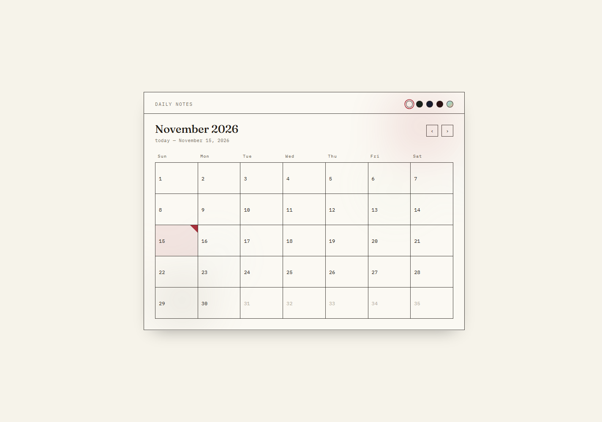
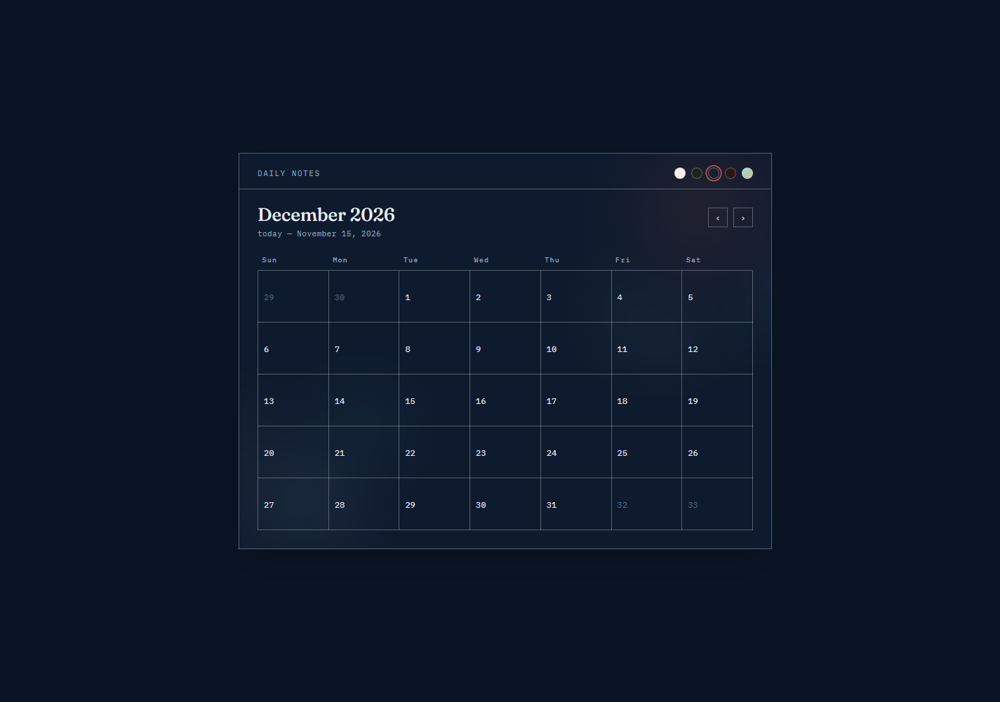
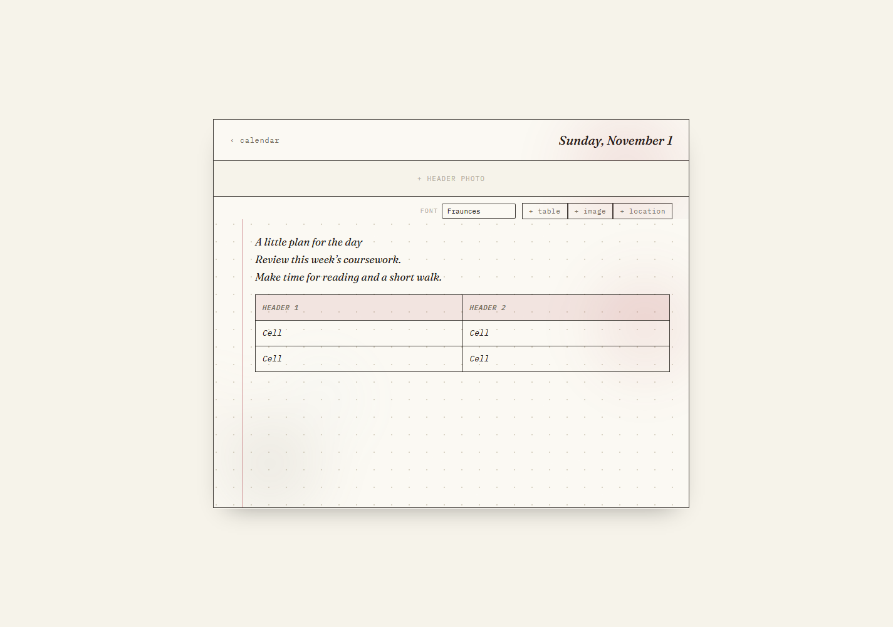
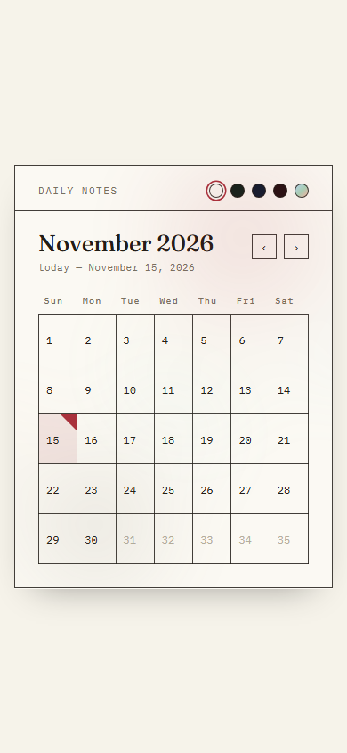

<div align="center">

# DayFlow 📅

**A calendar and daily notes experience for organizing your days and keeping plans in one place.**

Created by **Hasti Kabiri** · **Hastixie Studio**

<p>
  
  
  
  
</p>

<a href="https://vibecoding-calendar-website-cgue4q819-hasti-intern.vercel.app/"></a>

[Preview](#preview) · [Features](#features) · [Getting started](#getting-started) · [How to use](#how-to-use) · [Current limitations](#current-limitations)

</div>

> **Current status:** the supplied deployment redirects to Vercel sign-in. The screenshots below come from the unchanged local application. In an ordinary standalone browser, notes are retained only in page memory and are lost on refresh; the storage integration is not included in this repository.

## Preview

[](docs/screenshots/dashboard.png)

<table>
  <tr><th width="50%">Month navigation and Midnight theme</th><th width="50%">Date-linked note editor</th></tr>
  <tr>
    <td valign="top"><a href="docs/screenshots/calendar.png"></a></td>
    <td valign="top"><a href="docs/screenshots/note-editor.png"></a></td>
  </tr>
</table>

<details>
<summary><strong>Mobile layout</strong></summary>
<p align="center"><a href="docs/screenshots/mobile.png"></a></p>
</details>

These are real browser captures of the unmodified local source, made on November 15, 2026. Desktop images use a 1440 × 1000 viewport; mobile uses 390 × 844. Both external font families were loaded. Sample text was entered only in a new disposable browser profile; no existing notes, real location, or personal images were used. No storage adapter was injected. [Screenshot source and checks](docs/screenshots/source.json).

A separate event-management screenshot is not included because the application has a **daily note editor**, not a structured event-creation interface.

## About DayFlow

DayFlow is a small calendar and date-linked notes project for students and anyone who wants a simple place to outline a day. Browse a month, choose a date, and write a note with optional tables or images. Five visual themes and a notebook-style editor keep the interface focused on the date and its content.

The current application labels itself **Daily Notes** in the browser title and interface; **DayFlow** is the project name used in this repository. This documentation update does not rename or redesign the application UI.

## Features

| Feature | Verified behavior |
| --- | --- |
| Monthly calendar | Opens on the current month, displays a Sunday-first grid, highlights today's date, and navigates backward or forward across months and years. |
| Date-linked notes | Selecting an active date opens a `contenteditable` page. The back control returns to the calendar. |
| Same-page note recovery | Edits are copied to an in-memory fallback after a 500ms debounce and can be reopened while the same page remains loaded. This is not durable storage. |
| Typography | Choose Fraunces, IBM Plex Mono, Georgia, or Courier New for the note editor. |
| Themes | Switch between Paper, Forest, Midnight, Wine, and Aurora. Standalone theme persistence is unavailable without the external storage API. |
| Editable tables | Insert a table with 1–50 rows and 1–20 columns, then edit its header and cells in the note. The first row is the header. |
| Image attachments | Upload a header photo or inline image. The existing image editor exposes crop, rotate, apply, and cancel controls. Image-editing edge cases and touch interactions were not validated in this documentation pass. |
| Location helper | Enter a location label or request coordinates using the browser's geolocation permission flow. This is not a map or reverse-geocoding service; persistence has a known limitation below. |
| Small-screen layout | The calendar adapts to smaller widths, with mobile cell sizing and reduced-motion CSS. The 390px calendar capture has no horizontal overflow. |

The code does **not** implement timed events, recurring events, notifications/reminders, cloud synchronization, accounts, calendar-service integration, or a dedicated event edit/delete workflow.

## Technology stack

| Technology | Purpose |
| --- | --- |
| HTML5 | Calendar structure, note editor, upload inputs, and modal controls |
| CSS3 | Theme variables, notebook styling, layout, and responsive media queries |
| JavaScript | Date navigation, note interactions, tables, image processing, and location controls |
| Browser APIs | `contenteditable`, FileReader, Canvas, and optional geolocation |
| Google Fonts | Fraunces and IBM Plex Mono; system fallback fonts remain available |
| Vercel | Existing deployment destination, currently protected by sign-in |

There is no React, TypeScript, npm package manifest, backend, or application build pipeline in this repository. The documentation capture tool uses Node.js and Chrome separately from the application.

## Getting started

### Prerequisites

- A modern web browser.
- Git to clone the repository, or download the source from GitHub.
- Python 3 only if you want to use the optional HTTP server below.

### Clone the repository

```bash
git clone https://github.com/HastiKabiri/Calendar-Website.git
cd Calendar-Website
```

### Open locally

Open **`index.html`** in your browser. No dependency installation or build command is required.

Alternatively, serve the folder locally:

```bash
python -m http.server 8000
```

Visit **http://localhost:8000** and keep the terminal open. Stop the server with **Ctrl+C**. On systems that use `python3`, run `python3 -m http.server 8000` instead.

The browser downloads the two Google font families when network access permits. The application also declares system font fallbacks. Serving locally does not supply the missing storage adapter or make notes survive refreshes.

There is no `npm install`, `npm start`, or `npm run build` step for the app.

## How to use

1. **Browse a month** with the previous/next controls. Today is marked in the calendar.
2. **Choose an active date** to open its daily note.
3. **Write your plan** directly on the notebook page. Allow at least 500ms for the in-memory copy before navigating away.
4. **Add structure** with the font selector or `+ table`. Header and inline image controls are also available.
5. **Return to the calendar** using `‹ calendar`. Reopening the date recovers its note during the same page visit.
6. **Change the atmosphere** using the five theme swatches above the calendar.

Keep any important work in another durable document. Refreshing or closing this standalone page loses its in-memory notes.

## Current limitations

### Storage integration is absent

`script.js` calls a nonstandard `window.storage` API with `get`, `set`, `list`, and `delete` methods. No implementation is defined or loaded by `index.html`, and the code does not fall back to browser `localStorage`.

When that API is unavailable:

- Text, table content, and header-image state use the same-page memory fallback after the save debounce.
- Refreshing or closing the page loses those in-memory notes.
- Theme and font choices do not persist across reloads.
- Saved-note calendar markers and the successful-save indicator depend on storage calls completing; they are not evidence of durable saving in this standalone setup.
- The browser logs storage-related warnings. No replacement storage layer was added during this documentation update.

### Other observed limits

- **Calendar filler labels:** disabled trailing cells can show numbers beyond the month's actual dates, such as `31–35` after November 30. These cells are inactive; the screenshots preserve the current behavior.
- **Location persistence:** the save routine checks a `show` class on the location input that the current location UI does not set. A visible location label therefore should not be treated as reliably saved with its note.
- **Image editing:** desktop mouse handlers exist for cropping; complete touch behavior and non-square rotation/cropping cases are not verified here.
- **Event management:** a note can contain a plan, but there is no structured event record, start/end time, reminder, or dedicated event deletion feature.

These findings describe the existing implementation. Application fixes are outside this documentation-only change.

## Project structure

```text
Calendar-Website/
├── index.html                   # Calendar, daily-note editor, and modal markup
├── style.css                    # Five themes and responsive notebook styling
├── script.js                    # Calendar logic and note interactions
├── docs/
│   ├── assets/
│   │   └── hastixie-studio-logo.png
│   ├── screenshots/
│   │   ├── dashboard.png
│   │   ├── calendar.png
│   │   ├── note-editor.png
│   │   ├── mobile.png
│   │   └── source.json          # Capture source and observed behavior
│   ├── capture-screenshots.mjs  # Dependency-free Chrome capture tool
│   └── readme-review.md         # Documentation verification notes
└── README.md
```

The previous README referenced an `Assets/` gallery that was not committed to GitHub. Its broken references have been replaced with the real captures under `docs/screenshots/`; the separate older local `Assets` folder was left untouched.

## Documentation checks

JavaScript syntax can be checked with Node.js:

```bash
node --check script.js
node --check docs/capture-screenshots.mjs
```

To refresh the real local screenshots, use **Node.js 22+** and an installed Chrome browser:

```bash
node docs/capture-screenshots.mjs
```

The capture tool starts its own local static server, checks the supplied deployment in an isolated browser, waits for the external fonts, and captures the unchanged local application. It uses only generic sample text, does not inject `window.storage`, and records its observations in `docs/screenshots/source.json`. PNG compression is lossless.

The default Chrome path is the standard Windows installation. Set `CHROME_PATH` to another executable if needed, for example in PowerShell:

```powershell
$env:CHROME_PATH = 'C:\Program Files\Google\Chrome\Application\chrome.exe'
node docs/capture-screenshots.mjs
```

There is no existing application test runner or build script. The documentation check exercised month navigation, theme changes, note entry, table insertion, same-page recovery, refresh data loss, and mobile calendar overflow. It did not request a real location or inspect existing browser data. See the [review notes](docs/readme-review.md).

## Deployment

The configured project link is on **Vercel**:

**[Open the DayFlow deployment](https://vibecoding-calendar-website-cgue4q819-hasti-intern.vercel.app/)**

During verification, that URL redirected to **Vercel sign-in** instead of serving the calendar anonymously. No publicly accessible alternative URL is asserted, and no deployment settings were changed. README screenshots therefore use the latest local source.

No committed Vercel configuration or CI workflow establishes automatic deployment behavior. This repository's application is a static HTML/CSS/JavaScript site; the README does not claim a verified CI/CD pipeline.

## Hastixie Studio

<div align="center">

  

  <p><strong>Made with 💜 by Hastixie Studio</strong><br>Created by Hasti Kabiri</p>
  <p><a href="https://github.com/HastiKabiri">GitHub</a> · <a href="https://www.linkedin.com/in/hasti-kabiri-717551306/">LinkedIn</a></p>

</div>

---

<p align="center">Designed &amp; Developed by <strong>Hastixie Studio</strong>.</p>
